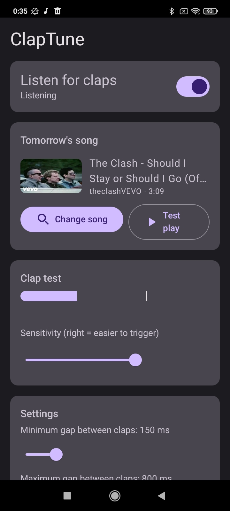

# ClapTune

**Clap twice, and your song plays.**

An Android app for that old phone in your drawer. Plug it in, leave it on the shelf, and it listens for a
double clap. When it hears one, it plays the song you picked the night before. With the screen
off, no Wi-Fi needed.

Think of the "clap and the music kicks in" moment from *a movie workshop*, built from a spare phone.

[](https://revolut.me/leonampa) [](LICENSE)



## Features

- **Instant, offline playback.** The song is saved locally in advance, so there is no buffering at clap time.
- **Always listening.** A foreground service keeps running with the screen off and the app closed.
- **Pick songs from inside the app.** Search YouTube, paste a link, or share a link from the YouTube app.
- **Tunable detection.** A live level meter and a sensitivity slider let you adjust it for your room.
- **No accounts or backend.** No sign-in, API key, ads or tracking. The only network traffic is the YouTube search
  and the one file download.

## How it works

1. Open the app, search for a song and tap a result. The audio is saved on the phone.
2. Turn on **Listen for claps** and leave the phone plugged in.
3. Clap twice. The song plays. Stop it from the notification or the app, or let it finish.

## Technical overview

### Clap detection

The detector (`ClapDetector`) is plain Kotlin with no machine learning and no native code. It is deterministic and
covered by JVM unit tests (11 tests).

- Input is mono 16-bit PCM at 16 kHz from `AudioRecord`, processed in 20 ms frames.
- Each frame's RMS is compared with an adaptive noise floor, a slow exponential moving average learned only from
  quiet frames. A clap must exceed `max(absolute minimum, noise floor × K)`, where `K` is set by the sensitivity
  slider.
- A candidate only counts if its energy drops sharply within about 60 ms, which is the shape of an impulse.
  Speech, music and sustained tones keep their energy up and are rejected.
- A 100 ms refractory period prevents one clap from being counted twice.
- A double clap is two claps separated by 150 to 800 ms (configurable). An optional triple-clap mode is available.
  A cooldown (default 10 s) follows each trigger.
- Detection pauses while the song plays, so the microphone does not react to its own speaker.

### Background listening

- A foreground service with `foregroundServiceType="microphone"` shows a persistent notification with
  **Stop listening** and **Stop music** actions.
- A partial wake lock keeps the CPU running with the screen off.
- If the microphone becomes unavailable (a phone call, another app), the service retries with exponential backoff.

### Getting the song

- [NewPipeExtractor](https://github.com/TeamNewPipe/NewPipeExtractor) handles YouTube search and stream extraction.
  It needs no API key or Google account. A small OkHttp `Downloader` connects it to the network.
- The best audio-only stream is selected: the highest-bitrate m4a, otherwise any progressive stream. It is
  downloaded in ranged 2 MB chunks.
- The download goes to a temporary file and replaces the current song only after it completes. A failed or
  cancelled download never affects the saved song.

### Playback

Media3 ExoPlayer, with audio focus handling, `ACTION_AUDIO_BECOMING_NOISY` handling, and optional fade-in, loop and
"set media volume to max".

### Stack

Kotlin, Jetpack Compose (Material 3), Coroutines and Flow, DataStore, Media3, OkHttp, Coil. Single Gradle module
using the Kotlin DSL. `minSdk 21`, `targetSdk 34`.

## Installation

Requires **Android 5.0 or newer**. Android 4.4 is not supported, because Compose, Media3 and NewPipeExtractor all
require API 21.

1. Get `ClapTune-1.0.apk` from the Releases page, or build it (see below).
2. Copy it to the phone, or run `adb install -r ClapTune-1.0.apk`.
3. Allow "Install unknown apps" when prompted.

## First run

1. Grant the **microphone** permission, and **notifications** on Android 13 and later.
2. Tap **Disable battery optimization** and allow it. This has the largest effect on whether the app keeps
   listening overnight.
3. Keep the phone plugged in.
4. Tap **Change song** and choose or paste a song.
5. Turn on **Listen for claps** and clap near the phone while watching the meter. The vertical line marks the
   trigger threshold. Adjust sensitivity until a clap clearly crosses it and normal speech does not.

## Building from source

Requires JDK 17 and the Android SDK (platform 34, build-tools 34.0.0).

```bash
echo "sdk.dir=$ANDROID_HOME" > local.properties
./gradlew testDebugUnitTest assembleDebug
# APK: app/build/outputs/apk/debug/app-debug.apk
```

### Release builds

`./gradlew assembleRelease` signs the APK with the key described in `keystore.properties` (git-ignored, so each
maintainer supplies their own):

```properties
storeFile=/path/to/release.jks
storePassword=...
keyAlias=...
keyPassword=...
```

Without that file the release build falls back to the debug key, so the project still builds for contributors.
APKs must always be signed with the same key to update in place, so keep the keystore backed up and private.

## Known limitations

- **Android 14 and later:** a microphone foreground service cannot be started from the background or at boot, so
  listening does not resume automatically after a reboot. Open the app and turn the switch on again.
- **Aggressive power management:** some manufacturers (Xiaomi, Huawei, Samsung, Oppo and others) may stop background
  apps regardless of settings. See [dontkillmyapp.com](https://dontkillmyapp.com), enable autostart if offered, and
  lock the app in the recents screen.
- **Microphone variation:** sensitivity depends on the phone's microphone and the room, so tune it on the actual
  device. The app has been tested on an Android 7.0 emulator, not yet on a physical phone with a real microphone.
- **Android 5 and 6:** these versions may lack the TLS ciphers YouTube prefers. If search fails while Wi-Fi works,
  that is the likely cause.
- **Volume:** playback uses the media volume. Enable "set media volume to max" if the phone's media volume is low
  or muted.

## Maintenance

### Updating the YouTube extractor

YouTube changes its internals from time to time, which breaks extraction until the library is updated. The version
is pinned in `gradle/libs.versions.toml` (`newpipe = "v0.26.5"`). To update, change it to the latest tag from the
[NewPipeExtractor releases](https://github.com/TeamNewPipe/NewPipeExtractor/releases) and rebuild. A song that is
already saved keeps playing offline.

### Android compatibility shim

NewPipeExtractor is compiled for JDK 11 and calls `URLEncoder.encode(String, Charset)`, which exists only on
Android 13 and later. `buildSrc/JdkCompatTransform.kt` rewrites those calls at build time to
`com.claptune.compat.JdkCompat`. If a future extractor version fails on older phones with a `NoSuchMethodError`,
add the missing method there.

## Legal notice

Downloading audio from YouTube may violate YouTube's Terms of Service. ClapTune is intended for personal use with
content you have the right to listen to, and for sideloading only. It is not suitable for distribution through
Google Play. You are responsible for how you use it.

## License

Licensed under the [GNU General Public License v3.0 or later](LICENSE). ClapTune is built on NewPipeExtractor,
which is GPL-3.0, so the app as a whole is distributed under the same license.

## Acknowledgements

[NewPipeExtractor](https://github.com/TeamNewPipe/NewPipeExtractor) provides the YouTube extraction. Also built on
Media3, OkHttp, Coil and Jetpack Compose.
